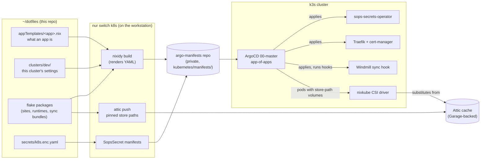

# How the Cluster Pieces Fit Together

A map of the k3s setup: what each piece does, and how a change in this repo becomes a running pod. The other pages in this folder go deep on single topics; this one links them together. The repo-wide layout is in [docs/architecture.md](../../../docs/architecture.md) and the `nur` commands in [docs/nur_commands.md](../../../docs/nur_commands.md).



## The pieces

| Piece | Where it's defined | What it does |
| --- | --- | --- |
| App templates | `appTemplates/<name>.nix` | What an app is: chart or hand-written resources, options, volumes. Wrapped by `mkArgoApp` (`modules/kubernetes/lib/mkArgoApp.nix`) into a nixidy module. |
| Cluster config | `clusters/dev/default.nix`, `clusters/dev/apps/<name>.nix` | This cluster's choices: which apps are on, ingress providers, NFS, database and redis targets, per-app settings. Apps declare `uses-database`/`uses-redis` and pick a provider with `databaseTarget`/`redisTarget`; nothing else should name a database or redis host. `redis.enable = false` turns an app's redis connection off. Apps that can't run without redis set `requires-redis`, and for those it fails the build instead. |
| nixidy | `modules/kubernetes/nixidy-envs.nix` | The second module system that renders all of the above into Kubernetes YAML ([nixidy-module-system.md](nixidy-module-system.md)). |
| argo-manifests | `git@github.com:duck1123/argo-manifests.git`, checked out at `kubernetes/manifests/` | The rendered YAML. The only thing ArgoCD reads. |
| ArgoCD | `appTemplates/argocd.nix`, app-of-apps `00-master` | Syncs every app from argo-manifests, with auto-sync, prune and `selfHeal` on. Manual `kubectl` changes get reverted ([deployment-workflow.md](deployment-workflow.md)). |
| nixkube (nix-csi) | `appTemplates/nix-csi.nix` | A CSI driver that mounts a Nix store closure into a pod at `/nix`. This is how apps run without a container image of their own ([nix-csi-and-binary-cache.md](nix-csi-and-binary-cache.md)). |
| Attic | `appTemplates/attic.nix`, storage on Garage | The LAN binary cache that nixkube pulls store paths from. |
| sops-secrets-operator | `appTemplates/sops.nix` | Turns `SopsSecret` manifests (encrypted in argo-manifests) into Kubernetes Secrets. |
| Traefik + cert-manager | `appTemplates/traefik.nix`, `appTemplates/cert-manager.nix` | Ingress and TLS. An app picks an `ingressProvider` (`traefik-lan`, `tailscale`, `traefik-dev` in `clusters/dev/default.nix`), which fills in its class, issuer and domain. |
| Homepage, AutoKuma | `appTemplates/homepage.nix`, `appTemplates/autokuma.nix` | Every app with an ingress gets a homepage link and an Uptime Kuma monitor by default ([homepage-dashboard.md](homepage-dashboard.md)). |
| Windmill sync | `appTemplates/windmill.nix`, `modules/kubernetes/pkgs/windmill-sync.nix` | A `Sync` hook job that pushes `resources/apps/windmill/wmill/f/**` into Windmill. |

## From an edit to a running pod

1. **Edit** an app template, a cluster setting, or a source a flake package builds (a site, a sync bundle). `git add` any new file: the flake only sees tracked files.
2. **`nur switch k8s`** (= `nur k8s deploy`) on the workstation:
   1. pulls `kubernetes/manifests/`;
   2. decrypts `secrets/k8s.enc.yaml` to a temp file (`DECRYPTED_SECRET_FILE`) and builds the nixidy environment. Every flake package an app references by store path (for example `storybook-runtime`, `windmill-sync-bundle`, `duck1123-runtime`) is built **locally** at this point, from the working tree;
   3. writes the YAML into `kubernetes/manifests/dev/`, adds `SopsSecret` manifests (`scripts/k8s-write-sops-secrets.sh`) and post-processes a few charts;
   4. **pushes every store path the manifests pin to Attic** (step 6 of `scripts/k8s-switch-charts.sh`). attic-watch-store on the workstations usually has them already; this step makes sure. Step 7 then lists those closures in `dev/attic/ConfigMap-attic-keepalive.yaml` for Attic's keep-alive job (see [nix-csi-and-binary-cache.md](nix-csi-and-binary-cache.md#garbage-collection));
   5. commits and pushes argo-manifests. **That push is the deploy.**
3. **ArgoCD** sees the new commit (or `nur argocd refresh <app>` to skip the wait) and applies it.
4. **Pods start.** A pod with a nixkube volume gets its store path from Attic (or upstream caches) and sees it at `/nix/var/result`. Secrets come from the operator. The ingress gets a certificate from cert-manager.
5. **Hooks** (`Sync`/`PostSync` jobs such as `windmill-sync` and `postgresql-init-databases`) run only on a sync **operation**, not on a refresh. After changing what a hook does, run `nur argocd sync <app>`.

The dotfiles commit itself is separate. Nothing in the cluster reads this repo from GitHub except through store paths built here, so the source change only has to be committed and pushed to keep history, not to deploy. One page still says otherwise for Windmill and needs checking; see below.

## Running code without images: the store-path pattern

Apps such as `duck1123`, `storybook`, `demo` and the Windmill sync job use `ghcr.io/lillecarl/nix-csi/scratch` (an empty image) and mount their whole runtime through nixkube:

```nix
volumes = [{
  name = "nix";
  csi = {
    driver = "nixkube";
    volumeAttributes."x86_64-linux" = "${self.packages.x86_64-linux.<runtime>}";
  };
}];
# container: volumeMounts = [{ name = "nix"; mountPath = "/nix"; subPath = "nix"; }];
```

The runtime package's `bin/` is on `PATH`, and its root is at `/nix/var/result`. Use the store path (`volumeAttributes."<system>"`), not a `nixExpr` string: nixkube evaluates `nixExpr` purely, so a literal store path inside one fails. The trade-off is that the path must be in a cache nixkube can reach, which is what step 2.4 above takes care of. Recipe for a static site: [static-sites.md](static-sites.md).

## Windmill

- `resources/apps/windmill/wmill/` is a `wmill` sync tree with `includes: f/**`. The `windmill-sync` hook runs `wmill sync push` from it, so **git owns `f/`**: anything under `f/` in Windmill that isn't in the tree is deleted. `u/<user>/` is never touched, so drafts can live there.
- The tree reaches the hook inside `windmill-sync-bundle`, a store path built at switch time like any other. The job mounts it by store path (`appTemplates/windmill.nix`), so it should reflect the local git-tracked tree. A comment in `windmill-sync.nix` and a note elsewhere say the bundle comes from the last *pushed* commit. **Unverified which is right**: confirm on the next `f/` change by deploying without pushing the dotfiles commit, then fix whichever is wrong.
- Secret values are seeded by the hook from sops, never through git (`skipSecrets: true`).
- Full-code (raw) apps: the `wmill` CLI bundles them locally with esbuild and runs `npm install` first if `node_modules` is missing. The hook pod has no npm, so a raw app under `f/` needs its `node_modules` built by Nix into the sync bundle.
- **Drafts in git:** `resources/apps/windmill/wmill/u/duck/` holds apps that are tracked here but outside the hook's `f/**`, deployed by hand with `wmill app push`. The inbox review app lives there (`u/duck/inbox_review.raw_app`, `nur inbox dev` / `nur inbox push`). It installs `resources/apps/dashboard-ui` as a copy (`install-links=true` in its `.npmrc`): a symlinked copy would resolve `react` from dashboard-ui's own `node_modules` and load React twice. Promoting it to `f/` means moving the folder and solving the `node_modules` point above.

## Which page for what

| Question | Page |
| --- | --- |
| How do I deploy, scale an app down, or force a sync? | [deployment-workflow.md](deployment-workflow.md) |
| Why does a new shared option say "does not exist"? | [nixidy-module-system.md](nixidy-module-system.md) |
| A pod is stuck in `ContainerCreating` on a nixkube volume, or Attic is failing | [nix-csi-and-binary-cache.md](nix-csi-and-binary-cache.md) |
| How do I keep a volume across redeploys? | [pinned-volumes.md](pinned-volumes.md) |
| How do I serve a Nix-built static site? | [static-sites.md](static-sites.md) |
| How do homepage groups and links work? | [homepage-dashboard.md](homepage-dashboard.md) |
| Something is broken | [troubleshooting.md](troubleshooting.md) |
